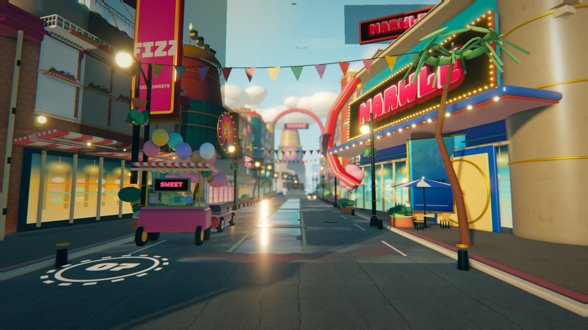
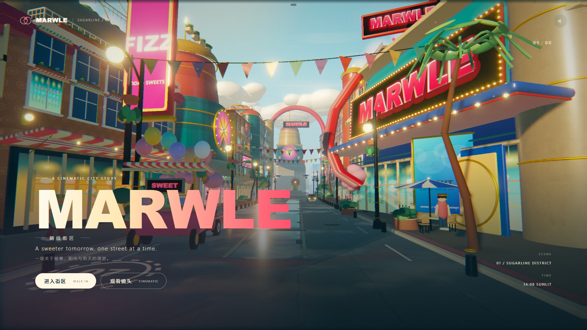
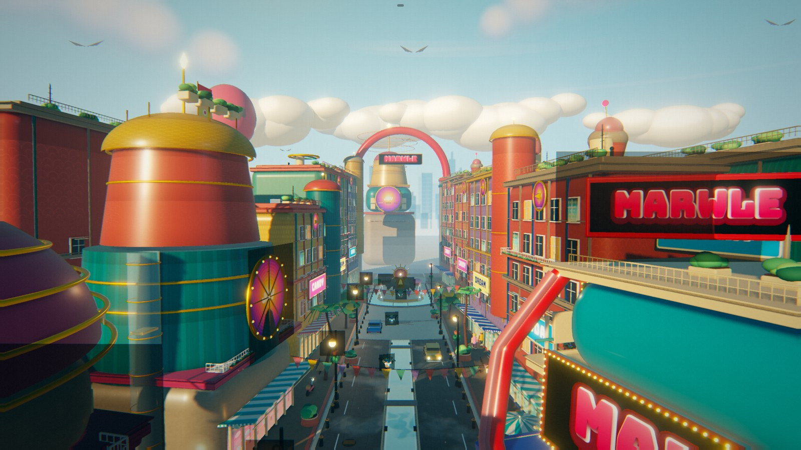
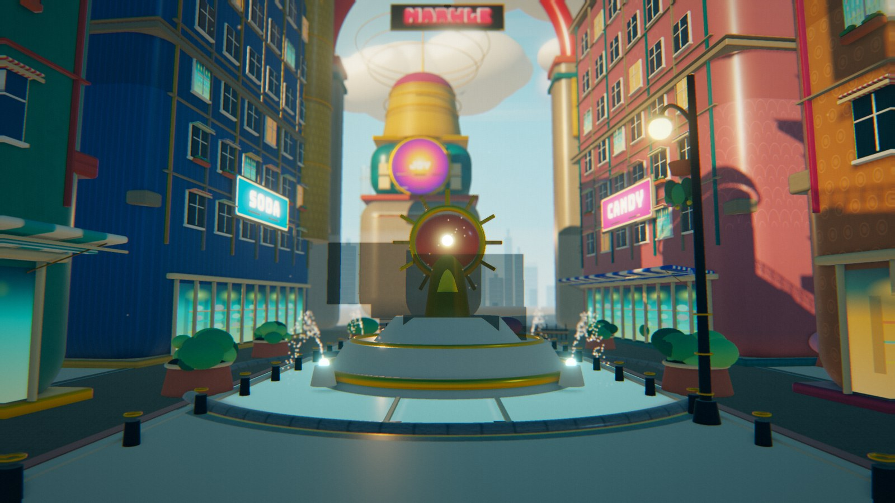
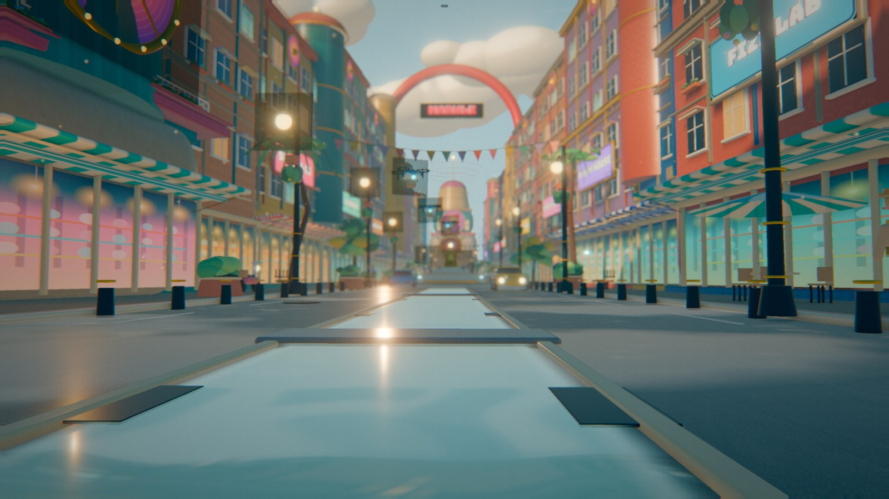

# MARWLE

**by DeepSeek-V4.1-flash 🐳**

**DSH-PTC**

**1 scene · 100% procedural**

[**Live preview**](https://cl0ud-99.github.io/marwle/) — runs in the browser, nothing to install.

A playable candy-city street: one long boulevard, a mirrored water lane, a fountain court and a painted sunset. Built in Three.js, but every building, sign, cloud, prop and sound in the scene is generated from code at load time. No model files, no imported HDRIs, no external audio.



## Views

| | |
|---|---|
|  |  |
|  |  |

## What it is

A one-scene interactive world preview with a small cinematic shell around it. Walk the avenue, switch to the auto camera, or jump between five composed shots.

| Path | Role |
| --- | --- |
| `src/main.js` | renderer, camera modes, input, UI wiring, post |
| `src/city.js` | boulevard assembly, ground, water lane, props, animation |
| `src/architecture.js` | Fizz Dome, Dream Tower, Marwle Hall, Sun Palace, generic buildings |
| `src/props.js` | lamps, trees, cars, pedestrians, fountain, candy cart, clouds |
| `src/water.js` | planar reflection + wet-pavement shader |
| `src/materials.js` | PBR materials, procedural facade patterns, sign canvases |
| `src/sky.js` | 4096×2048 equirect sky, cumulus, PMREM environment |
| `src/post.js` | HDR composer, bloom, sun scattering, ACES grade, optional GTAO + DOF |
| `src/quality.js` | quality presets (draft / standard / cinematic / photo) |
| `src/audio.js` | procedural Web Audio ambience |
| `site/` | built static site deployed to GitHub Pages |

## Render pipeline

A conventional forward renderer, but tuned around three things: reflections, baked shadows and a soft print-like finish.

```
4096 × 2048 procedural sky ──> PMREM environment ──> PBR specular / IBL
             │
             └──> scene background

static city (≈4.5M tris at high detail)
   ├──> sun shadow map, baked once (1024² / 3072² / 4096² by preset)
   ├──> planar reflection RT (scaled 0.7–1.5×, 1–4 frame cadence, layer 0 only)
   └──> HDR scene RT (0–4× MSAA) → optional GTAO → optional DOF

HDR scene
   ├──> bloom
   ├──> radial sun rays
   └──> composite: lens distortion, chromatic fringe,
        ACES, split-tone grade, vignette, film grain, sRGB
```

Details worth reading:

- **The shadow map is baked once.** The architecture is static, so the sun shadow map is rendered during the first frame and then frozen. Its resolution follows the quality preset (1024² draft, 3072² standard, 4096² cinematic/photo), and the ortho box is trimmed to the playable corridor.
- **Planar reflections are throttled and layer-culled.** The mirror camera renders only the static layer; the reflection scale and cadence follow the quality preset. Moving props live on layer 1 and stay out of the reflection pass entirely, which removes a large slice of draw calls.
- **The grade is AgX.** The final pass uses the Filament/Blender AgX curve with a re-tuned exposure, saturation and contrast, so marquee bulbs and sun glints roll off instead of clipping to white. `?tonemap=aces` restores the older ACES curve for comparison.
- **Photo mode is a different renderer.** `?shot=` and the `P` key switch to the photo preset: higher device pixel ratio, 4096² shadows, full-rate reflections, GTAO and a subtle depth-of-field pass focused per composed shot, so stills are much cleaner than the walk view.
- **The shader rejects early.** The mirror plane is much larger than the area that can ever be wet, so the fragment shader discards anything outside the canal and pool bounds before it runs the noise and reflection taps.
- **Reflection is masked, not global.** One mirror RT drives both the water lane and the plaza pool, plus the damp road sheen. The shader masks by world position so asphalt stays matte and the canal reads as wet.
- **The whole static city is merged by material.** Hundreds of authored meshes collapse into roughly sixty draw calls; the remaining draw calls are moving characters, sprites, signs and transparent glass.
- **Moving props are merged in local space.** A pedestrian, cart, fountain or drone keeps one root transform for animation while its bodywork collapses into a handful of per-material meshes.
- **Collision is volumetric, not a rail.** The walk camera and every pedestrian resolve their radius against building footprints, cars, the candy cart, benches, planters, lamps, bollards and the fountain. NPC lanes sit on the sidewalk and are gently pulled back to them, so walkers slide around obstacles instead of clipping through walls.
- **Light has a second bounce.** A warm directional fill lifts undersides and awnings, 520 additive dust motes drift through the boulevard as a cheap volumetric cue, and the sun-ray pass is slightly stronger.
- **Moving props do not bake shadows.** They are excluded from the frozen sun map and carry a soft contact patch instead, so nobody leaves a shadow behind.
- **Canopies use alpha cards.** Puff trees keep a few sphere clumps for volume and add 26 alpha-tested leaf cards per tree, merged into one mesh per tree; the cards opt out of the baked shadow map so they do not leave square shadows.
- **Only the three landmarks get the ultra tier.** Hero LOD switches tessellation to `ultra` while building Fizz Dome, Dream Tower and Marwle Hall, then drops back to the base tier for the rest of the street.
- **Hero windows have real depth.** On the three landmark buildings the glazing sits behind a projecting surround with four reveal jambs and a drip sill, so the sun drops a shadow into the opening. Background rows keep the cheap flat unit.
- **Mouldings are profiled, not boxes.** Cornices are built from four stepped slabs (bed, fascia, cove, crown), and flat roofs carry AC units, vents, water tanks and antennas for a busier silhouette.
- **Materials carry dirt and relief.** Wall paints blend a seeded grime/AO sheet, paving and walls bake a height-gradient into their normal maps (three ignores bumpMap when normalMap exists), and the road/sidewalk run a real parallax-occlusion pass: a 6-step height ray-march displaces the colour, roughness and AO UVs, so paving reads as depth rather than a decal. Glass has stronger clearcoat and iridescence.

## Audio

Synthesised in the browser — no samples:

- a slow, filtered major-seventh pad;
- brown-noise air and water layers with independent LFOs;
- randomly panned pentatonic glass chimes with synthesized delay;
- triggered only after the first click, as browsers require.

## Running it

```bash
npm install
node build.mjs --site
node serve.mjs
# open http://127.0.0.1:4173/
```

For a single offline file:

```bash
node build.mjs --single
# dist/MARWLE-Sugarline-District.html
```

No server is needed for the single file; every image, font and audio graph is embedded or synthesised.

## Controls

| Input | Action |
| --- | --- |
| Enter / click button | Start first-person walk |
| Mouse drag | Look around |
| W A S D / arrows | Walk |
| Shift | Run |
| Space | Jump |
| C | Cinematic camera |
| P | Photo mode (hide HUD; press again to return) |
| 1 – 5 | Composed camera presets |
| H | Hide interface |
| Sound button | Toggle procedural ambience |

## URL parameters

| Parameter | Effect |
| --- | --- |
| `?ui=0` | Hide all overlays for clean captures |
| `?shot=hero` | Start on a fixed composed camera |
| `shot=fountain,water,sign,street,skyline` | Other composed cameras |
| `freeze=1&t=10` | Freeze the world clock at a chosen time |
| `?quality=low` | Draft preset: 0.85× DPR, 1024² shadows, low detail |
| `?quality=high` | Standard preset (default): 1.35× DPR cap, 3072² shadows |
| `?quality=cinematic` | 1.5× DPR, 4096² shadows, 4× MSAA, GTAO |
| `?quality=photo` | 1.75× DPR, 4096² shadows, 4× MSAA, GTAO, DOF, full-rate reflections |
| `?detail=low` | Coarser geometry tessellation |
| `?detail=ultra` | Higher geometry tessellation for close-ups |
| `?cinema=1` | Start straight into the cinematic camera |
| `?tonemap=aces` | Use the older ACES curve instead of AgX |

Screenshots shown here were captured with `?shot=…&ui=0&freeze=1&t=10`.

## Deployment

The **Deploy to GitHub Pages** workflow runs on every push to `main`, uploads `site/` and publishes it via GitHub Pages. `node build.mjs --site` emits a small `site/app.js` plus hashed, cacheable assets under `site/assets/`, while `--single` still inlines everything into one offline HTML. There is no build step on the runner; the committed `site/` is the exact playable artifact, so a page that cannot load is caught before pushing.

The app uses relative paths and works both at a domain root and under the `/marwle/` sub-path used by Pages.

## Notes on the look

The scene is deliberately mid-century picture-book rather than photoreal: chunky rounded volumes, saturated sugar colours and cream trim, with one long golden-hour shadow giving weight. The palette keeps coral, teal, butter yellow and cobalt in a narrow family so the street can be busy without becoming noise.

Water is pushed toward turquoise and sky-reflective, while the asphalt stays a chalky warm grey. The strongest light is behind the viewer, so facades facing the street stay luminous and the cast shadows fall toward the fountain.

All building layouts and prop placement use seeded randomness, so the street looks organic but reloads identically every time.

## Screenshots

The full 1920×1080 captures are in `docs/shots/`. The uncompressed UI screenshots and offline build live under `shots/` and `dist/` in the working tree.

## Credits

- Three.js — MIT.
- esbuild — MIT.
- Poly Haven textures — CC0: `asphalt_02`, `concrete_pavers_03`, `painted_plaster_wall`, `marble_tiles`.
- Bungee and Outfit — SIL OFL.
- Everything else — original procedural scene, shaders, geometry, UI and audio.

MARWLE is a fictional brand.  
Made as a real-time playable world preview.
